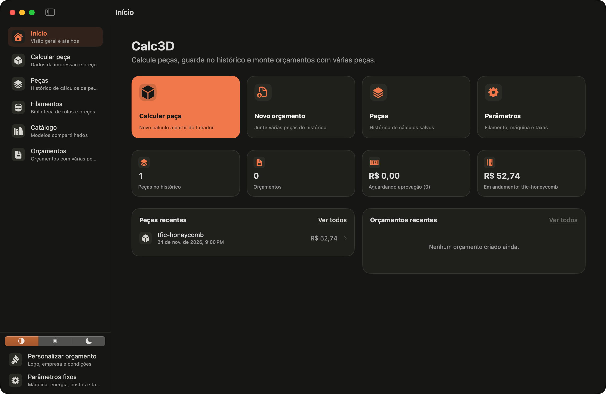
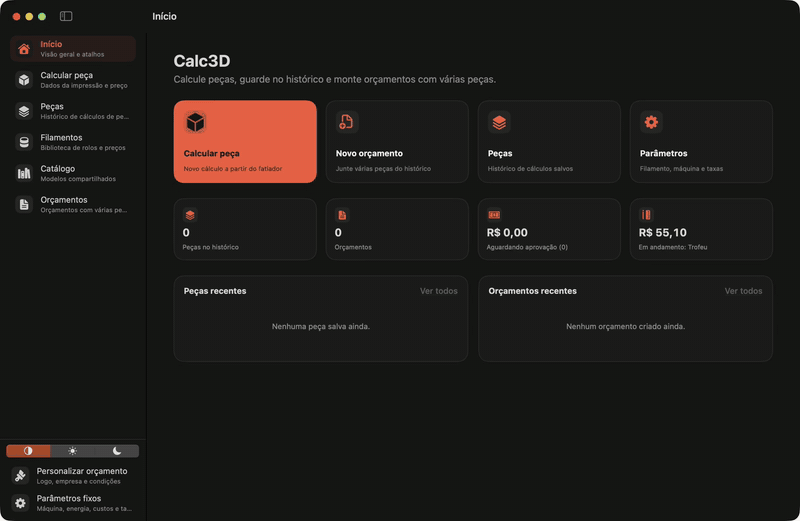

# Calc3D

App nativo para macOS (SwiftUI, Apple Silicon) que calcula o custo real e o preço de venda de peças impressas em 3D.

<p align="center">
  
</p>

Também há uma **versão web** em [`web/`](web/), que roda inteira no navegador (veja [Versão web](#versão-web)), e um **app para Windows** em [`windows/`](windows/) (veja [App para Windows](#app-para-windows)).

## Requisitos

- macOS 14 Sonoma ou superior (Apple Silicon ou Intel)
- Para compilar: Swift 6 (Command Line Tools: `xcode-select --install`) ou Xcode

## Instalação

**[⬇ Baixar a última versão do Calc3D (.dmg)](https://github.com/hceregatti/Calc3D/releases/latest/download/Calc3D.dmg)** · [notas e versões anteriores](https://github.com/hceregatti/Calc3D/releases)

Abra o `.dmg` e arraste o **Calc3D** para **Aplicativos**.

O app não é notarizado pela Apple, então na primeira abertura o macOS bloqueia. Libere em **Ajustes do Sistema → Privacidade e Segurança → Abrir Mesmo Assim**, ou pelo Terminal:

```bash
xattr -dr com.apple.quarantine /Applications/Calc3D.app
```

**Atualizações**: o app avisa quando há uma versão nova ao abrir, e o menu **Calc3D → Verificar se há
Atualizações…** faz a checagem na hora. Ele consulta a API do GitHub e, se ela recusar (limite de 60
consultas por hora sem login), usa a página pública de releases, então a busca continua funcionando.
A atualização baixa o `.dmg`, troca o app e o reabre.

Para publicar uma nova versão, atualize `CFBundleShortVersionString` e `CFBundleVersion` em `Resources/Info.plist` (e a versão em `web/package.json` e `windows/package.json`), faça push da `main` e depois envie a tag (`git tag v1.0.1 && git push origin v1.0.1`): o workflow `release.yml` gera o `.dmg` (macOS) e o instalador `.exe` (Windows) e anexa os dois ao Release.

## Comandos

```bash
make app       # compila em release (universal) e gera build/Calc3D.app
make dmg       # gera o instalador build/Calc3D-<versão>.dmg
make open      # gera e abre o app
make install   # copia o app para /Applications
make run       # executa em modo debug
make test      # roda os testes do motor de cálculo
make clean
```

## Estrutura

```
Package.swift
Sources/
  Calc3DCore/                  # Regras de negócio puras, sem UI (testáveis)
    ShopSettings.swift         #   parâmetros fixos + custos por hora derivados
    PrintJob.swift             #   dados de cada impressão
    CostCalculator.swift       #   motor de cálculo (todas as fórmulas)
    CostResult.swift           #   resultado, categorias, erros de precificação
    QuoteSummary.swift         #   texto do orçamento + formatação em R$
    Filament.swift             #   biblioteca de filamentos e estoque
    CatalogStore.swift         #   lista os modelos 3MF/STL da pasta do catálogo
    AppUpdate.swift            #   versões semânticas e releases do GitHub
  Calc3D/                      # App macOS (SwiftUI)
    App/Calc3DApp.swift        #   ponto de entrada, janela e menus
    ViewModels/                #   estado da tela (Observation)
    Persistence/               #   salva parâmetros no UserDefaults
    Import/                    #   leitura de STL/3MF (fatiamento, impressora, miniaturas, estimativa de
                               #   peso por volume) e abertura nos fatiadores
    Models/AppearanceMode.swift #  modo claro/escuro/automático
    Views/
      ContentView.swift        #   barra lateral com as telas
      PrintJobView.swift       #   tela de impressão: dados da peça + resultado
      ShopSettingsView.swift   #   tela de parâmetros fixos
      ResultsPanel.swift       #   preço, indicadores e composição do custo
Tests/Calc3DCoreTests/         # testes (swift-testing)
Resources/Info.plist           # metadados do bundle .app
scripts/
  build-app.sh                 # build release + montagem e assinatura do .app
  build-dmg.sh                 # empacota o .app em um instalador .dmg
  make-icon.swift              # gera o ícone do app em código
```

## Telas

<p align="center">
  
</p>

- **Início** (⌘1): atalhos (calcular peça, novo orçamento), números gerais e peças/orçamentos recentes.
- **Calcular peça** (⌘2): o que muda a cada peça. Nome, peso e tempo do fatiador, peças por mesa,
  preparação, pós-processamento, insumos e margem, com o resultado ao lado. Cada peça aceita uma
  **foto** (clique ou arraste uma imagem para o quadro ao lado do nome). "Salvar peça" guarda o
  cálculo e a foto no histórico; "Adicionar a orçamento" inclui o cálculo atual direto em um
  orçamento, já com a foto.
- **Peças** (⌘3): histórico de cálculos de peças, com os parâmetros originais e a foto (miniatura na
  lista, imagem no detalhe). Selecione várias
  (⌘-clique/⇧-clique) para gerar um orçamento ou adicioná-las a um orçamento existente.
- **Filamentos** (⌘4): biblioteca de rolos com preço, cor e peso restante. A peça usa o preço do filamento
  escolhido, e o consumo dos orçamentos pode dar baixa no peso restante do rolo. Para remover um
  rolo, use "Excluir" na ficha (no macOS também na barra de ferramentas ou no clique direito); peças
  já calculadas mantêm o preço usado na época.
- **Catálogo** (⌘5): pasta compartilhada com modelos 3MF/STL já configurados (veja [Catálogo](#catálogo)).
- **Orçamentos** (⌘6): orçamentos com várias peças, quantidades, cliente e exportação em PDF.
  "Calcular nova peça…" abre o mesmo formulário da tela Calcular peça (inclusive importação de
  STL/3MF) e adiciona o preço sugerido ao orçamento, opcionalmente salvando a peça no histórico.
  "Adicionar do histórico…" inclui várias peças já salvas de uma vez. A fila separa orçamentos
  aguardando, vencidos e vendas.
- **Parâmetros fixos** (⌘7 ou ⌘,): configurados uma vez. Filamento padrão (escolhido na biblioteca),
  energia, máquina, valor da hora, embalagem, custos fixos, taxa de falha, impostos e taxas de venda.
  Mostra quanto custa uma hora de máquina e permite salvar alterações explicitamente.
- **Personalizar orçamento** (⌘8): logo, dados e contatos da empresa, cor do PDF, rodapé,
  numeração e condições padrão (validade, pagamento, prazo, observações). Cada produto do
  orçamento aceita uma foto; sem foto, o PDF usa uma imagem padrão.

⌘N inicia uma nova peça, ⇧⌘N cria um novo orçamento e ⇧⌘C copia o resumo da peça.

### Aparência

- **Modo claro/escuro**: o seletor no rodapé da barra lateral escolhe entre **Automático** (acompanha
  o sistema), **Claro** e **Escuro**. A escolha fica salva neste Mac ou neste navegador.
- **Cor de destaque**: terracota (`#C2410C` no claro, `#F2784B` no escuro) em botões primários, item
  ativo da barra lateral, foco dos campos, links e no preço sugerido. As categorias do gráfico de
  custo têm cores distintas para facilitar a leitura.
- **Cursor**: botões, menus e itens clicáveis das listas mostram o cursor de mãozinha ao passar o mouse
  (botões desabilitados mantêm o cursor normal).

### Importar STL e 3MF

Na tela Calcular peça, "Importar STL ou 3MF" preenche o nome e, quando possível, o peso e o tempo:

- **3MF fatiado** (Bambu Studio/Orca): o app lê as estimativas gravadas pelo fatiador em
  `Metadata/slice_info.config`: peso, tempo e filamentos de cada mesa. Com mais de uma mesa fatiada,
  você escolhe qual usar (no Catálogo).
- **3MF sem fatiamento ou STL**: o arquivo não traz peso nem tempo. O app **estima o peso pelo
  volume** da malha (casca + preenchimento, com a densidade e o preenchimento do projeto, ou PLA a
  15% se não constarem) e avisa que é uma aproximação. O tempo de impressão não é estimado: preencha
  o valor do fatiador.

## Catálogo

O Catálogo é uma pasta compartilhada (iCloud Drive, Google Drive, Dropbox, rede…) com arquivos
3MF/STL já configurados. Ele não guarda cálculos: cada pessoa lê as informações do arquivo e calcula
com os próprios parâmetros.

- **Escolher a pasta**: na primeira vez, selecione a pasta; subpastas também são lidas. Arquivos da
  nuvem ainda não baixados são avisados e entram ao atualizar.
- **Enviar arquivo**: copia 3MF/STL do computador para a pasta, sem sobrescrever (nomes repetidos
  viram "nome 2").
- **Imagem do modelo**: a lista mostra uma miniatura e o detalhe, a imagem em tamanho maior. Em 3MF
  vem da capa/miniatura gravada no próprio arquivo; em STL (ou 3MF sem imagem) é gerada pelo Quick Look.
- **Detalhe do modelo**: formato, pasta, mesas, peso, tempo e filamentos lidos do arquivo, e o custo e
  o preço sugeridos com os seus parâmetros (quando há peso e tempo do fatiador).
- **Impressora do projeto**: para 3MF, mostra a impressora para a qual o arquivo foi configurado, o
  bico, a altura de camada e o perfil de impressão (lidos de `Metadata/project_settings.config`,
  mesmo em arquivos não fatiados).
- **Calcular**: abre o modelo em Calcular peça. **Salvar**: guarda a peça calculada no seu histórico.
  **Baixar**: salva uma cópia do arquivo no computador. **Mostrar no Finder** e **Excluir** (vai para
  a Lixeira e some para todos que usam a pasta).
- **Abrir no fatiador**: dois cartões, um para o **Bambu Studio** e outro para o **Creality Print**,
  com o ícone do aplicativo instalado. Um clique abre o modelo no fatiador; o que não estiver em
  Aplicativos aparece esmaecido como "Não instalado". O app abre uma cópia temporária, então salvar
  no fatiador não altera o arquivo compartilhado. As mesmas opções estão no clique direito da lista.

## Modelo de custo

| Componente | Fórmula |
|---|---|
| Filamento | peso × (1 + desperdício) × preço do rolo ÷ peso do rolo |
| Energia | W ÷ 1000 × horas × tarifa |
| Depreciação | (preço − revenda) ÷ vida útil × horas |
| Manutenção | manutenção anual ÷ horas/ano × horas |
| Custos fixos | fixos mensais ÷ horas/mês × horas |
| Falhas | (filamento + energia + máquina + fixos) × f ÷ (1 − f) |
| Mão de obra | (preparação + pós) ÷ 60 × valor/h |
| Insumos | insumos por mesa + embalagem × peças |
| **Preço** | (custo/peça + taxa fixa) ÷ (1 − margem − impostos − taxa %) |

Peso e tempo são da mesa inteira; o custo é dividido pelo número de peças.

## Notas de build sem Xcode

- Os macros `@State` e `#Preview` do SwiftUI dependem de plugins que só vêm com o Xcode, então o projeto não usa nenhum dos dois.
- O `make test` passa ao compilador os caminhos do swift-testing que existem nas Command Line Tools.
- O app é assinado ad-hoc. Se for copiado para outro Mac, o Gatekeeper pode pedir para liberar o app em
  Ajustes do Sistema › Privacidade e Segurança.

## Versão web

Em `web/` está a mesma calculadora em React + TypeScript (Vite), sem servidor: tudo roda e fica
salvo no navegador (localStorage para os dados, IndexedDB para logo e fotos). As fórmulas são
uma tradução direta do `Calc3DCore`, com os mesmos testes.

Requer Node.js 18+.

```bash
make web        # instala dependências e abre em http://localhost:5173
make web-test   # testes do cálculo e dos orçamentos (vitest)
make web-build  # gera web/dist/, pronto para hospedar em qualquer servidor estático
```

- **PDF**: "Gerar PDF" abre a visualização; "Imprimir / Salvar PDF" usa a impressão do navegador
  (escolha "Salvar como PDF" e desmarque "Cabeçalhos e rodapés"). Rodapé e número de página em
  todas as folhas funcionam no Chrome/Edge.
- **Backup**: os dados ficam só no navegador onde foram criados. Em Parâmetros fixos → Backup dos
  dados, exporte um arquivo JSON (inclui as imagens, como as fotos das peças) para guardar ou importar em outro computador.
- **Hospedagem**: `web/dist/` usa caminhos relativos, então funciona no GitHub Pages, Netlify,
  Vercel ou em qualquer pasta de um servidor.
- **GitHub Pages**: o workflow `.github/workflows/pages.yml` roda os testes, gera o build e publica
  a cada push na `main` que altere `web/`. Endereço: https://hceregatti.github.io/Calc3D/

## App para Windows

Em `windows/` está o Calc3D para Windows 10/11 (64 bits), um app desktop em [Electron](https://www.electronjs.org/)
que embute a versão web (`web/`, mesmas fórmulas, telas, orçamentos em PDF e backup) e acrescenta o que no
macOS vem do sistema:

| macOS | Windows |
|---|---|
| Catálogo (⌘5) com miniaturas do Quick Look | Catálogo (Ctrl+5): miniatura embutida no 3MF ou desenhada pelo app a partir da malha |
| Abrir no Bambu Studio / Creality Print (em Aplicativos) | Mesmos cartões; procura os programas em `Arquivos de Programas` e `AppData\Local\Programs`, com o ícone do `.exe` |
| Estimativa de peso por volume, mesas e impressora do 3MF | Idem (também na versão web) |
| Excluir vai para a Lixeira, "Mostrar no Finder" | Vai para a Lixeira do Windows, "Mostrar no Explorer" |
| Menus e atalhos ⌘1…⌘8, ⌘N, ⇧⌘N, ⇧⌘C, ⌘, | Os mesmos com Ctrl no lugar de ⌘ |
| Atualização pelo `.dmg` do GitHub Releases | Baixa o `Calc3D-Setup.exe` do Release, fecha o app e abre o instalador |

> **Aviso**: o app para Windows foi pouco testado. Ele foi desenvolvido e verificado no macOS (testes automatizados e
> execução no Electron), e o instalador ainda não foi experimentado num Windows real. Pode haver falhas, principalmente
> na detecção do Bambu Studio/Creality Print, no instalador e na atualização automática. Se encontrar algo,
> [abra uma issue](https://github.com/hceregatti/Calc3D/issues).

**Instalação**: o `.exe` só aparece nos [Releases](https://github.com/hceregatti/Calc3D/releases) a partir da primeira
versão publicada depois da inclusão do app Windows (o workflow gera o instalador quando a tag `vX.Y.Z` é enviada).
Com ele disponível, baixe o [Calc3D-Setup.exe](https://github.com/hceregatti/Calc3D/releases/latest/download/Calc3D-Setup.exe)
e execute (instala só para o seu usuário, sem pedir administrador). O instalador não é assinado, então o
SmartScreen pode avisar na primeira vez: clique em **Mais informações → Executar assim mesmo**.

Os dados (parâmetros, peças, orçamentos, filamentos e fotos) ficam no próprio app, em
`%APPDATA%\Calc3D`, e não são compartilhados com o macOS: para levar os dados de um computador a outro,
use **Parâmetros fixos → Backup dos dados**.

```bash
make windows        # roda em modo desenvolvimento (funciona também no macOS)
make windows-test   # testes do app Windows e do que ele reaproveita da web
make windows-dist   # gera windows/release/Calc3D-Setup-<versão>.exe (execute no Windows)
```

Requer Node.js 18+. O instalador é gerado no Windows (ou no GitHub Actions, workflows `release.yml` e
`windows.yml`). Estrutura:

```
windows/
  main.cjs, preload.cjs   # processo principal: janela, menu, catálogo, fatiadores, atualização
  lib/                    # lógica sem Electron (testada em test/): catálogo, fatiadores, versões, releases
  renderer/               # tela do Catálogo e ligação com o menu; importa o código de web/src
  assets/icon.png         # ícone do app e do instalador
```

## Licença

Distribuído sob a licença MIT. Veja o arquivo [LICENSE](LICENSE).
